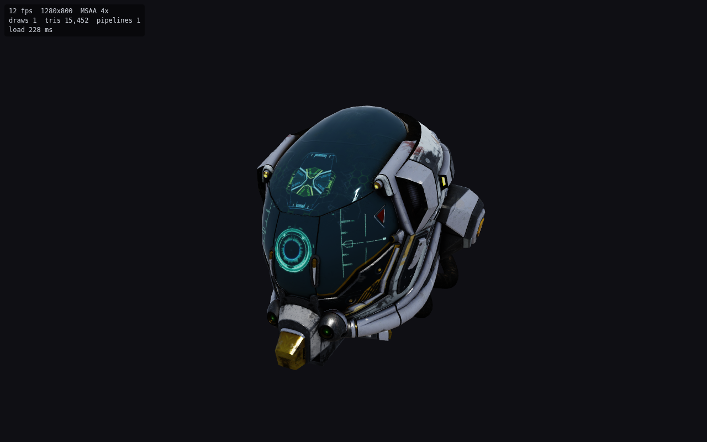

# webgpu-engine

A minimal, dependency-light **browser / WebGPU** rendering engine skeleton in TypeScript.
It is the first of a family of per-platform engines: each runtime is tailored to its
target, and a shared offline asset pipeline (later) bakes glTF into the format each
runtime wants.

Runtime dependency: [`wgpu-matrix`](https://github.com/greggman/wgpu-matrix) (math only).
Dev tooling: Vite, TypeScript, `@webgpu/types`, `puppeteer-core` (only for the headless screenshot check).



## Running

```bash
npm install
npm run dev        # http://localhost:5173  (WebGPU needs https or localhost)
npm run build      # type-check + production bundle in dist/
npm run preview    # serve dist/
npm run screenshot # headless Chrome + SwiftShader render -> screenshot.png (after build)
```

URL options: `?model=/path/to/file.glb` (or `.gltf`), `?msaa=1` (disable 4x MSAA),
`?dpr=1.5` (cap device pixel ratio, useful on phones to save fill-rate).

Controls: drag to orbit, right/middle/shift-drag to pan, wheel to zoom.
Touch: one finger orbits, two fingers pinch-zoom and pan.

## Architecture

```
src/
  core/        gpu.ts        adapter/device/canvas setup, clear "WebGPU unsupported" errors, device-lost hook
               resize.ts     ResizeObserver (device-pixel-content-box) -> canvas size * DPR, optional DPR cap
               frameLoop.ts  rAF loop with clamped dt
  renderer/    renderer.ts   forward renderer: 4x MSAA -> resolve into swap chain, depth, draw sorting
               pipelines.ts  bind-group layouts, vertex layouts, pipeline-variant cache (alpha mode x culling)
               material.ts   material description + uniform packing + sort keys
               mesh.ts       GPU buffers for primitives (non-interleaved streams)
               textures.ts   image upload, GPU mipmap generation, 1x1 defaults, sampler cache
  scene/       node.ts       scene graph: TRS -> local/world/normal matrices with dirty flags
               camera.ts     perspective camera (WebGPU 0..1 depth)
               scene.ts      scene root, one directional light, hemisphere ambient
               bounds.ts     AABB helpers (framing; later culling)
  assets/      gltf.ts       glTF 2.0 / GLB parser -> engine-neutral CPU data (no GPU calls)
               geometry.ts   generate missing normals / tangents, bounds
               modelLoader.ts CPU data -> GPU resources + scene subtree
  shaders/     pbr.wgsl      metallic-roughness PBR (GGX, Smith-GGX correlated, Schlick), ACES tonemap
               mipmap.wgsl   downsample blit
  controls/    orbit.ts      orbit camera on Pointer Events (mouse + touch + pinch), damped
  main.ts      demo app: init, load model, frame it, run loop, HUD
```

### Key design choices

- **Data flows one way:** `assets` parses into plain typed arrays + descriptors, `modelLoader`
  is the only module that knows both glTF and the renderer. A future loader for the baked
  format will sit beside it and skip parsing entirely.
- **Bind groups by update frequency:** group 0 = per frame (camera/light), group 1 = per
  material, group 2 = per draw. All per-draw matrices go into **one** uniform buffer, written
  with **one** `writeBuffer` per frame, and selected with dynamic offsets.
- **Draw sorting** by a numeric key (blend pass | pipeline variant | material) minimises
  pipeline and bind-group switches; vertex/index buffers are only rebound when the primitive changes.
- **Pipelines are cached and pre-warmed** at material creation, so the first frame does not hitch.
- **MSAA 4x with `storeOp: 'discard'`** on the multisampled color and depth: only the resolved
  image is written to memory, which matters a lot on tile-based mobile GPUs.
- **sRGB done by hardware:** the canvas is configured with an `*-srgb` view format; base color
  and emissive textures are uploaded as `rgba8unorm-srgb`, data textures as linear.
- **Mipmaps generated on the GPU** at load time (a baked pipeline will ship them precomputed).
- **Non-interleaved vertex streams** (position / normal / uv / tangent) keep the loader simple
  and allow a depth-only pass to bind positions alone later.
- **Tangents generated only when a normal map needs them**; missing normals are computed.

### glTF support

`.glb` and `.gltf` (external files or data URIs); TRIANGLES primitives; POSITION, NORMAL,
TEXCOORD_0, TANGENT; uint8/16/32 indices (or none); interleaved, normalized and sparse
accessors; node TRS or matrix; base color, metallic-roughness, normal, occlusion and emissive
textures with samplers; alpha OPAQUE / MASK / BLEND; doubleSided; `KHR_materials_emissive_strength`.

## Known gaps (deliberate for a skeleton)

- One sampler per material (taken from its first texture); TEXCOORD_1 and `KHR_texture_transform` ignored.
- No animation, skinning, morph targets, cameras or lights from glTF; no Draco/meshopt; KTX2 not yet.
- BLEND materials are drawn after opaques but not sorted back-to-front.
- No frustum culling or instancing yet; draw list is rebuilt every frame.
- Ambient is a hemisphere term + analytic env-BRDF, not image-based lighting; no shadows.
- Tangent generation is Lengyel-style, not full MikkTSpace (the baker should emit MikkTSpace tangents).

## Roadmap

1. **KTX2 / Basis Universal textures:** transcode to ASTC (mobile), BC7 (desktop) or ETC2 at load
   time based on `adapter.features` (`texture-compression-astc` / `-bc` / `-etc2`); precomputed mips.
2. **LODs:** per-mesh LOD chains (meshoptimizer simplification in the baker), selected by projected
   screen-space size, with hysteresis.
3. **Frustum culling:** world AABB per node (already computed for framing) tested against camera planes;
   later a BVH and GPU-driven culling with indirect draws.
4. **Instancing:** batch identical (mesh, material) pairs into one `drawIndexed(count, instances)` with
   per-instance transforms in a storage buffer.
5. **Asset baking pipeline (shared across engines):** glTF in -> per-platform packages out: quantized
   and interleaved vertex layouts, meshopt-optimized index order, MikkTSpace tangents, LODs,
   GPU-compressed textures, a tiny binary header the runtime can map straight into GPU buffers.
6. Then: IBL (prefiltered env + BRDF LUT baked offline), shadow maps, a render-graph-lite for passes,
   render bundles for static geometry, timestamp-query profiling.

## Headless screenshot notes

`npm run screenshot` launches Chrome with a software SwiftShader Vulkan adapter:
`--enable-unsafe-webgpu --enable-features=Vulkan --use-vulkan=swiftshader --use-angle=swiftshader --use-webgpu-adapter=swiftshader`.
Without `--enable-features=Vulkan --use-vulkan=swiftshader` the swap-chain shared image cannot be
created in headless mode and the device is lost after a couple of frames. Override flags with
`CHROME_GPU_FLAGS=...` and the browser with `CHROME=/path/to/chrome`. Frame rates in this mode are
CPU-rendered and meaningless for performance.
